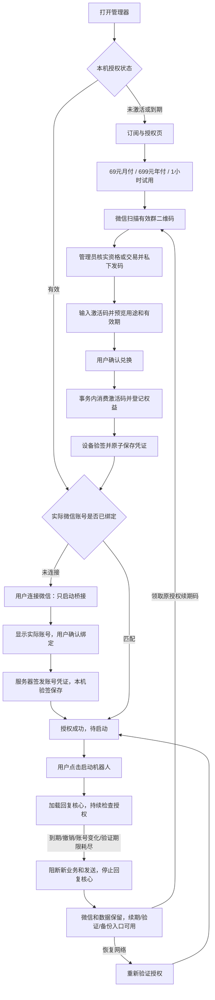

# 订阅与授权：实现方案、完整链路及 TODO

> 2026-10-25 新增一小时自助试用：第 9 节保留已确认的需求基线，第 10 节记录实现及验证范围。源码实现不代表已部署服务、启用商业授权或更新本地机器人。前 8 节保留原人工发码方案和历史验证记录。

> 2026-10-09，目标版本 0.9.9。首版采用微信群二维码人工发码。授权服务已接入 `https://ss.xiuxianjyj.xin/wechatrebot-license`，客户端已填入生产公钥；商业开关仍关闭，客户安装包尚未更新。
> 本文替代此前的在线支付、短信登录草案，作为本功能的统一实施清单。

## 1. 已确认的规则

| 项目 | 实现规则 |
| --- | --- |
| 月付 | 69 元 / 1 个日历月 |
| 年付 | 699 元 / 12 个日历月 |
| 试用 | 免费 1 小时，通过微信群领取试用码；首次兑换成功起计时，不从打开软件时计时 |
| 开通方式 | 查看套餐 → 微信扫码入群 → 管理员核实 → 私下发码 → 客户预览并确认兑换 |
| 二维码 | 当前为 WXRebot 群，2026-10-16 00:00（北京时间）截止；服务器替换后客户端下次刷新生效 |
| 授权单位 | 一个授权编号、一个有效设备身份、一个机器人微信账号 |
| 客户身份 | 管理员维护稳定客户参考号；服务端保存其哈希，不要求客户注册或提交聊天内容 |
| 续费 | 人工核实后发针对原授权编号的续期码，不自动扣款 |
| 周期 | 北京时间日历月 / 年，服务端存 UTC 时间戳；保留月底锚定日，闰年按日历处理 |
| 提前续期 | 从原有效期接续；试用转付费保留剩余试用时间 |
| 已到期续期 | 从本次成功兑换时间重新起算，不收暂停期间的费用 |
| 模型费用 | 客户自备模型服务和密钥；授权服务不代理聊天、模型请求或保存模型密钥 |
| 离线使用 | 同次 Windows 开机内签名凭证最多 24 小时，且不超过订阅截止；重启电脑后需联网校时 |
| 到期 | 暂停自动化、停止回复核心，保留微信连接、配置和客户数据 |
| 恢复 | 授权重新有效后由用户点击启动；不自动恢复，不补发旧任务和消息 |

首版没有在线付款、付款回调、短信登录、自动扣款、分销或按消息计费。人工交易由管理员核实，“兑换成功”不表示已经核验任何第三方付款。

## 2. 从打开软件到使用的闭环

授权状态读取及每 4 秒的状态轮询不访问授权接口，也不自动创建设备身份。预览、兑换、绑定、重新验证和运行时后台刷新才发出授权请求。群二维码通过独立匿名接口首次读取、每 60 秒更新，用户也可主动刷新；不读取设备凭据、微信账号或聊天资料。二维码请求延迟或失败不阻塞授权表单。状态读取失败会显示原因，不伪装为有效授权。

| 步骤 | 客户操作 / 所见 | 后台处理 | 中断后的处理 |
| --- | --- | --- | --- |
| 进入 | 状态、套餐、截止时间 | 读取本机凭证和实际微信状态 | 服务未配置时明确提示待配置 |
| 加群 | 微信扫码，可放大二维码，显示北京时间有效期 | 从固定 HTTPS 服务读取 PNG/JPEG 资料，服务端原子更新 | 过期/清空则隐藏图片；刷新失败只可回退仍有效内置图并显示失败原因，已有激活码仍可兑换 |
| 领取 | 告知管理员新开通、续期或恢复意图 | 核实稳定客户身份、交易或试用资格 | 同一业务编号不能重复发码 |
| 预览 | 输入码，核对套餐、用途、预计截止时间 | 校验码但不消费；生成有效 5 分钟的预览凭据 | 失效或授权版本改变需重新确认 |
| 兑换 | 明确点击确认兑换 | 同一事务消费码、登记权益、绑定设备，随后签发 | 响应丢失可重试，不重复加时、不要求再次购买 |
| 设备激活 | 设备已激活，待连接微信 | 验证签名、设备、nonce、版本和期限后原子落盘 | 写盘失败不能显示成功，可重新领取原权益 |
| 连接 | 点击连接微信并登录 | 只启动桥接、识别实际身份 | 不加载回复插件、模型或定时业务 |
| 绑定 | 查看真实账号并确认 | 再次读取账号，和用户确认值比对后绑定 | 如果切换了账号则拒绝，要求重新查看 |
| 就绪 | 套餐、截止时间、微信账号、授权编号 | 回读已保存凭证 | 可以继续配置模型，不隐式启动 |
| 启动 | 点击启动机器人 | 校验授权与账号、创建运行会话、加载回复核心 | 失败保留微信，清除运行许可后允许重试 |

账号来自当前机器人桥接状态，不能以任意输入的 wxid 作为绑定依据。设备激活、微信绑定和机器人已经运行分别展示。

二维码有效期独立于试用及付费期限。客户端以服务端时间、请求耗时及单调时钟计算二维码剩余时间，页面按该剩余时间隐藏图片；修改本机时钟不能延长展示。已经收到服务端清空结果的管理器进程，后续断网不会重新展示内置旧图。页面的“刷新二维码”只读取管理员最新上传的资料，不能替微信群生成新码。

## 3. 激活码生命周期

服务使用安全随机码，数据库仅保存摘要。码是领取服务端权益的秘密凭据，不能在客户端离线推导有效期。管理员工具只在服务器本机运行，没有公网管理员接口。

| 码用途 | 管理员需提供 | 兑换结果 | 是否增加时长 |
| --- | --- | --- | --- |
| 新开通 `new` | 稳定客户参考号、唯一业务编号、试用/月付/年付 | 新权益绑定兑换设备 | 是，从首次兑换开始 |
| 续期 `renewal` | 原授权编号、同一客户参考号、业务编号、月付/年付 | 更新原 `license_id`，保留设备和微信 | 是，按提前/到期规则接续 |
| 补领 `recovery` | 原授权编号、同一客户参考号、业务编号 | 原设备重新取得原权益 | 否，保留原截止时间 |
| 迁移 `migration` | 原授权编号、目标设备指纹、同一客户参考号、业务编号 | 明确迁移设备；可显式重置微信绑定 | 否，保留原截止时间 |

- 未兑换码默认 30 天内领取，管理员可指定 1～365 天；领码期限与订阅时长分开。
- 预览凭据绑定设备、码、目标授权及版本；不能拿别人的预览凭据兑换。
- 同设备重试已兑换码恢复当前原权益，不再加时；另一设备不能靠旧码抢走授权。
- 并发兑换使用写事务，保证只有一个设备获得该码权益。
- 试用历史按稳定客户、设备和微信账号检查；重发码不重置历史。管理员不能以变化的订单号替代客户身份。
- 签发或传输失败不会退回已消费码；再次请求原权益即可恢复交付。
- 撤销未用码只撤销该码；停用已兑换权益必须按授权编号撤销。

### 重装、换机与换微信

设备私钥由 Windows 当前用户 DPAPI 保护。正常重开应用保留设备身份；同设备丢失授权缓存可用补领恢复。私钥丢失、换 Windows 用户或换电脑时，需要管理员迁移，不能悄悄重置后重新试用。

新安装在订阅页点击“获取本机设备编号”，显式生成身份并复制指纹给管理员。管理员核实购买者后签发锁定新指纹的迁移码。默认保留原微信；只有核实换微信请求后才允许重新绑定。

新设备已有同一客户的试用或已到期付费授权时，迁移预览会同时展示将被停用的本机授权和迁入的原授权。明确确认后，在同一事务中完成替换，保留原到期时间和试用历史，不合并时长。不同客户、不同设备、已撤销或仍有效的付费授权不能直接替换。响应丢失后可用同一码恢复此次迁入，不能借此切换任意授权。

迁移或撤销在旧设备下次联网刷新时生效。旧设备已持有的有效离线凭证，最长仍可使用 24 小时且不超过订阅截止；首版不承诺离线时即时踢下线。

## 4. 到期、断网及恢复

| 状态 | 后台行为 | 客户可做什么 |
| --- | --- | --- |
| 授权有效 | 执行前和发送前检查，运行中约每 30 分钟刷新 | 正常使用，提前兑换续期码 |
| 服务暂不可达，凭证仍有效 | 按当前签名截止继续使用，失败退避 | 查看剩余期限，主动验证 |
| 订阅到期 | 拒绝新业务和最终发送，清除运行许可，退出回复核心 | 领取续期码；查看、备份和导出数据 |
| 离线凭证过期 | 暂停，说明需要联网验证 | 恢复网络，点击重新验证 |
| 已撤销/已迁移 | 收到拒绝或签名撤销状态后暂停 | 联系管理员 |
| 系统时钟异常 | 暂停并要求联网校准；重启不重新赠送试用 | 校准系统时间后重新验证 |
| 实际账号不匹配 | 拒绝业务并暂停，不能自动改绑 | 登录原微信或申请明确换绑 |
| 已恢复有效授权 | 保持暂停，等待用户启动 | 点击启动机器人 |

正常暂停保留微信桥接。若后台刷新占用授权锁或授权存储故障，导致运行许可不能可靠撤销，则额外停止桥接进程以阻断残留发送；保留客户数据，并提示稍后重新连接。重新连接必须先成功清除旧运行许可，不能借旧会话恢复自动化。

关闭软件或重启电脑后，在桥接和回复核心均未运行时，仍可凭本机经过签名及设备校验的账号绑定查看、导出自己的历史记录。页面标明“离线记录”并禁用删除；离线数据身份不会冒充已登录微信，不能用于绑定、启动或其他业务操作。缓存损坏、账号不匹配或桥接状态未确认时，拒绝使用该后备身份。

期限由服务端签名时间与本地单调时钟共同判断，`lease_until` 不超过 `valid_until`。持久化 Windows 内核启动标识；重启电脑或单调时钟回退后必须联网校时，避免恢复旧缓存再调时钟延长试用。到期检查不等待网络刷新返回，也不依赖管理器窗口存活。

回复核心、流水线阶段、模型调用、桥接业务入口和最终写入均检查授权。登录、健康检查和必要读取保持可用；消息业务在身份处理后被过滤。出站队列绑定运行会话，恢复时不补发旧会话内容；核心退出会丢弃内存中的旧任务。

到期前已经发往外部服务的请求可能完成，不能承诺撤回已送出的网络请求；返回后仍须通过发送前检查。任意第三方插件在本机执行自定义 Python 的情况下，也不能把这套本地保护描述为“无法破解”。服务端只信任自己的权益、签名和事务记录。

## 5. 代码结构与复用

| 位置 | 职责 |
| --- | --- |
| `licensing/protocol.py` | 唯一套餐定义、严格 JSON、签名协议、日历周期 |
| `licensing/config.py`、`licensing-channel.json` | HTTPS 服务、公钥和商业开关；商业包固定信任根 |
| `licensing/contact.py`、`contact_client.py`、`licensing-contact.json` | 公共二维码校验、独立请求/缓存/可信时间和内置有效图，不进入回复核心 |
| `licensing/client.py`、`device.py`、`cache.py` | 设备密钥、本机验签、可信时间、运行会话和原子持久化 |
| `licensing/api.py`、`app_shell.py` | 复用现有本地 API、动作锁和生命周期 |
| `app_webui/subscription.js`、`subscription.css` | 复用主界面导航、确认弹窗、提示和维护入口 |
| `launcher.py`、`lifecycle.py` | 复用进程身份校验、接管和完全停止检查，分阶段启动、只停回复核心；保留旧任务迁移门禁 |
| `licensing/runtime_guard.py`、核心/桥接补丁 | 独立刷新、执行检查、最终发送检查和旧队列隔离 |
| `backup.py` | 复用备份与恢复校验，排除并拒绝恢复授权私钥/状态/配置 |
| `services/activation_service/` | aiohttp 客户接口、SQLite 权益事务、管理员本地发码及更新二维码 |
| `deploy/activation-service/`、`deploy/nginx/wechatrebot-license*.conf` | 独立容器、受限端口、托管和 HTTPS 路由；复用已有域名 |
| `licensing/bundle.py`、构建脚本 | 同一源码复制最小运行时模块并校验指纹，拒绝复用旧授权核心；商业包的管理器增量同样检查授权基线 |

表中管理器路径均相对 `src/wechatrebot_manager/`。沿用现有 cryptography、原子 JSON、单实例锁和进程管理。服务器私钥、激活码数据库和管理员工具不进入客户包。

## 6. TODO 与验收状态

### 已实现及自动验证

- [x] 69 元/月、699 元/年、1 小时试用，服务端和客户端共享规则。
- [x] 微信二维码、内置回退提示、过期隐藏和服务端清空；领取入口异常不阻塞兑换。
- [x] 二维码 60 秒缓存及单独刷新，不随授权状态轮询下载；页面倒计时不受本机墙钟回拨影响。
- [x] 预览及明确兑换；轮询不清空输入。
- [x] 新开通、续期、补领、迁移、撤销；重复兑换、并发和响应丢失恢复。
- [x] Ed25519 请求与凭证、nonce 防重放、版本校验、限流和日志脱敏。
- [x] DPAPI 及原子持久化；商业包开关、公钥和服务地址固定。
- [x] 只连接微信 → 实际账号确认 → 绑定 → 用户启动；API 和进程入口均校验。
- [x] 到期只停止回复核心，续期后明确恢复；授权存储损坏也不能阻止停止进程。
- [x] 到期且完全离线后，可查看和导出已验证账号的本机历史；禁止跨账号读取及离线删除。
- [x] 备份不导出设备私钥/授权缓存，恶意备份也不能覆盖这些文件。
- [x] 真实临时 HTTP 服务的客户端联调：激活、到期、续期、撤销、响应丢失和迁移。
- [x] 浏览器预览验证兑换、绑定、显式启动及输入保留。
- [x] 运行时补丁定向验证：执行、模型、最终发送、旧队列与延迟动作跨会话隔离。
- [x] 复用仓库 `vendor/` 固定源码验证补丁，不新增重复源码副本。
- [x] 商业管理器增量检查授权模块和核心补丁基线；不兼容时拒绝更新，不自动构建。

代码提交、PR 和完整 CI 的交付状态以本功能 PR 的当前检查结果为准；本地定向测试不代替 CI 或真实安装验收。

### 正式启用前必须完成

- [x] 接入用户提供的 WXRebot 微信群二维码，明确 2026-10-16 零点截止。
- [x] 47.242.208.64 上部署独立授权容器，复用 ss.xiuxianjyj.xin HTTPS，保持 NTP、独立账号和仅回环端口。
- [x] 在受控目录初始化独立私钥、数据库、systemd 托管及容器健康检查。
- [x] 公网健康、二维码内容、请求签名与重放拒绝验证；原网站和稳定更新清单内容保持一致。
- [x] 将真实 HTTPS 服务和公钥写入包内 `licensing-channel.json`，二维码独立配置。
- [x] 以专用账号执行每日 SQLite 在线备份，保留最近 14 份；现场验证独立容器恢复数据库、私钥和二维码。
- [ ] 启用商业开关，再构建、验收商业包。
- [ ] 将受控备份复制到独立存储，并完成异机灾备演练。
- [ ] 干净安装验证真实微信登录、绑定、到期停止、续期恢复、换机和数据保留。
- [ ] 维护者明确授权后进行完整载荷构建、安装验收及发布。

当前包内 `enabled:false` 保持既有安装行为，商业授权尚未启用。`config/licensing.json` 仅供默认未启用包本地联调；正式商业包使用包内信任根，忽略本地覆盖。服务已上线与客户安装包已启用收费是两个独立状态。

整个授权功能涉及 AstrBot 核心补丁和运行时模块，属于 **完整载荷更新**，不能只更新管理器。本轮已部署独立授权服务，没有构建客户载荷、更新本地安装或发布客户包。将来需要本地完整载荷时，使用桌面“本地打包完整载荷”入口，并先完成当次构建确认。之后日常替换群二维码无需重新构建客户包或回复核心。

## 7. 管理员交付指引

服务器操作、发码、撤销、查询、恢复和迁移参数统一维护在 [授权服务 README](../../services/activation_service/README.md)，当前服务器路径和核验结果见 [部署记录](../../deploy/activation-service/README.md)。管理员保存业务编号、稳定客户参考号和授权编号，不通过客户备份保存设备凭据。

恢复授权时先区分“同设备丢缓存”“私钥丢失/换电脑”和“增加时间”，分别使用补领、迁移和续期。不要以再次发一个新开通码代替已有权益恢复。

## 8. 本地验证记录

以下命令均在本功能独立工作区执行，只使用临时数据、受控签名测试对象、HTTP 测试服务或进程替身。各组包含交叉测试，不累计为独立用例总数。

| 定向命令 | 结果 |
| --- | --- |
| `python -m pytest tests/test_activation_service.py tests/test_license_protocol.py tests/test_license_client.py tests/test_license_client_integration.py tests/test_license_runtime_guard.py -q` | 223 通过 |
| `python -m pytest tests/test_license_history.py tests/test_license_api.py tests/test_license_lifecycle.py tests/test_app_shell.py tests/test_launcher.py tests/test_lifecycle.py tests/test_history_webui.py tests/test_subscription_webui.py -q` | 165 通过 |
| `python -m pytest tests/test_license_api.py tests/test_legacy_migration_api.py tests/test_subscription_webui.py tests/test_license_history.py tests/test_startup_errors.py -q` | 后续边界补充，46 通过 |
| `python -m pytest tests/test_local_incremental_update.py tests/test_license_runtime_patches.py tests/test_staging_builder.py tests/test_build_local_package.py tests/test_runtime_builder.py tests/test_release_metadata.py -q` | 构建入口及补丁集成，100 通过 |
| `python -m pytest tests/test_backup.py tests/test_build_manager.py -q` | 23 通过，构建过程使用替身 |

上述表格为此前激活码主体的验证记录；本轮微信二维码改动另执行定向测试及浏览器验证，结果以当前 PR 为准。生产验证已覆盖 HTTPS 接口和客户端匿名取码，不代表真实微信、完整载荷或已安装客户版本已经验收。

2026-10-09 微信二维码及部署补充验证：

- `python -m pytest tests/test_activation_contact_service.py tests/test_activation_service.py tests/test_license_contact.py tests/test_license_contact_client.py tests/test_license_api.py tests/test_license_protocol.py tests/test_license_client.py tests/test_license_client_integration.py tests/test_license_runtime_guard.py tests/test_dev_manager.py tests/test_build_manager.py tests/test_subscription_webui.py -q --tb=short`：333 通过。
- `python -m pytest tests/test_activation_backup.py -q --tb=short`：21 通过，1 个 POSIX 专用断言在 Windows 跳过；Ubuntu 22.04 / Python 3.10 原生权限、WAL、跨用户拒绝、锁与轮转验证通过。
- 相关 Python 编译、JS 语法、`python scripts/validate_release_metadata.py` 和 `git diff --check` 通过。
- Edge 浅色/深色，1440×1180、1080×680、390×844：二维码展开、每 60 秒更新、过期隐藏、输入保留、过期码图下续期保持暂停，控制台无错误。
- 生产 HTTPS、实际客户端匿名读取、无效码拒绝、nonce 重放拒绝、原站点内容保持、首次备份与独立容器恢复均已验证；没有生成或兑换生产客户激活码。

## 9. 一小时自助试用需求草案（2026-10-25）

### 9.1 目标、范围与确认状态

目标：客户在“订阅与授权”页开启一次免费试用，激活成功后连续体验一小时；到期强制暂停机器人，不能通过重装、换电脑或重复点击重新领取。原试用区域提示购买，方便试用转付费。

需求整理阶段仅形成本节文档；随后授权开发的实现及验证范围见第 10 节。

| 规则 | 状态 |
| --- | --- |
| 试用入口位于“订阅与授权”原免费试用区域 | 用户已提出 |
| 激活成功开始计时，一次 3600 秒，到期暂停机器人 | 用户已提出 |
| 不能通过换电脑、重新安装再次试用 | 用户已提出 |
| 到期原位置显示“你的试用已结束，可联系群主购买” | 用户指定文案 |
| 用户在订阅页点击“激活免费试用”自助领取，不需群主先开放 | 用户已确认；点击即申请激活，无需试用码 |
| 按当前设备和当前机器人微信账号分别判断一次性资格 | 用户已确认；设备或账号任意一项已试用过，均不得新领 |
| 旧流程中已兑换但从未绑定微信的历史试用如何衔接 | 待确认兼容规则；不能仅凭新设备上的当前微信识别原客户 |

本期按“用户自助领取、每台设备一次、每个机器人微信账号一次”整理。两项限制独立成立，不按“设备与账号的组合”计次。仅两者都未使用且通过其他资格校验时允许首次领取；已使用的设备换微信、已使用的微信换设备，均不能产生新的试用。范围不扩展为自然人身份识别：设备和微信都换成从未试用过的新身份时，不能仅凭这两项判定仍是同一个人。

### 9.2 激活与计时

1. 初始在免费试用卡片展示“一小时免费试用”、规则摘要和“激活免费试用”按钮；进入页面、读取资格、连接微信均不消耗试用。
2. 未连接微信时，先引导连接并登录，读取当前真实账号，仅提供身份核验所需能力；未激活前不执行回复、插件、定时任务或消息发送。
3. 展示当前微信账号并提示：“每台设备、每个微信账号均限试用一次。激活后连续计时 1 小时，关闭软件或电脑不会暂停。”设备或账号无法确认时不能领取；禁止通过手工填写昵称、微信号字符串或复制他人身份领取。
4. 用户点击“激活免费试用”即提交激活，不另要求试用码或群主审批。服务端再次确认当前设备和账号均有资格，在同一成功事务中登记两项已使用历史、创建试用并绑定本次设备与账号；该事务的时间记为 T0，到期时间固定为 T0 + 3600 秒。不能出现已发放试用但其中一项历史尚未登记的状态。
5. 激活成功后显示“试用中”、剩余时间和到期时间；保留现有“用户主动启动机器人”规则，激活不等于自动启动。模型配置时间、用户尚未启动、停止机器人、关闭管理器、关机和断网均计入这一小时。
6. 未点击激活或服务端未成功创建权益，不消耗资格、不开始计时。服务端成功但响应丢失、客户端保存失败时，原设备与原账号重试恢复同一试用及原 T0，不重复赠送时间；未取得可验证的授权前不能运行。
7. 双击、多窗口、同一设备以不同微信申请，或同一微信在不同设备申请，只能产生一次试用。并发判重必须同时覆盖设备和账号；失败请求不得刷新已有试用的起止时间，也不应消耗失败请求中尚未使用的另一项身份。
8. 计时依据服务端可信时间；修改系统时间、时区、恢复旧授权缓存不能延长试用。重开应用后显示服务端记录的剩余时间；时间或身份无法可靠验证时暂停，并提供重新验证入口，不显示虚假的“试用已结束”。

开启入口采用用户已确认的“激活免费试用”按钮，是一次性领取动作；规则在按钮附近提前展示，激活中禁止重复操作。激活后原按钮替换成试用状态，不设置可以反复关开的试用开关，不允许暂停、清零或延长时间。用户停止运行机器人使用既有停止按钮。

### 9.3 页面状态与文案

| 状态 | 原免费试用区域 | 允许的操作 |
| --- | --- | --- |
| 身份未确认 | 设备未确认显示原因；未登录显示“连接微信后查看试用资格” | 核验设备与微信身份；不先显示有资格 |
| 设备、账号均未使用且符合资格 | “一小时免费试用”，“激活免费试用”按钮 | 阅读规则，点击后直接申请激活 |
| 正在激活或结果待确认 | “正在确认试用状态…” | 禁止重复领取；可重新查询原请求结果 |
| 正在试用 | “试用中”，剩余时间、固定到期时间 | 配置、主动启动/停止机器人、购买 |
| 试用已结束且无有效付费权益 | **“你的试用已结束，可联系群主购买”** | 联系群主、查看群二维码、输入付费激活码；不能再试用 |
| 当前设备或账号已被其他试用使用，当前组合无可恢复权益 | “当前设备或微信账号已领取过试用，可联系群主购买” | 禁止新领，不透露其他账号或试用详情；不能借另一项新身份使用原试用 |
| 已购买且授权有效 | “已开通正式授权”，显示现有套餐和期限 | 按正式授权正常使用；不被旧试用到期停用 |
| 资格查询失败、断网或账号变化 | 显示具体可恢复状态 | 联网重试、核对微信身份；不能把失败当成新用户 |

试用到期后入口应禁用或替换成结束状态，不能只有前端按钮隐藏。同一账号换电脑或同一设备重装后，核验身份并查询成功仍不能新领；原试用已结束时展示指定结束文案。未登录前不能声称已识别账号，设备记录也不得暴露此前使用者的微信或授权详情。二维码失效时继续使用现有刷新/错误状态，不阻塞已有付费激活码的兑换。

“不可再次激活”仅指免费试用；月付、年付、续费、补领和已购买权益恢复继续可用。

### 9.4 到期强制暂停的边界

- 当可信时间达到 T0 + 3600 秒，且没有已生效的正式付费权益时，立即失去机器人业务执行和发送资格，不设置额外试用宽限期。
- 阻断新消息处理、AI/工具业务执行、自动回复、语音和媒体发送、群管理业务、定时/主动任务和后台插件发送；最终发送前必须重新核验资格，不能只靠页面倒计时或“启动”按钮控制。
- 到期前已经开始的模型、联网或语音任务，不得在到期后继续发送结果；可取消的任务取消，不能取消的外部请求返回后丢弃业务结果。到期前已提交外部服务的请求及已发出的消息无法承诺撤回。
- 到期保护不得依赖管理器窗口存活；关闭窗口、进程重启或断网不能绕过。在线无法校验时可使用仍有效且未过试用截止的可信凭证；凭证失效、重启后不能可信校时或其他校验失败时暂停，不延长试用。
- 保留管理器、配置、模型密钥、聊天记录、备份/导出、授权查询和购买入口；不删除数据，不退出用户个人微信。优先暂停回复核心与自动化；只有无法可靠阻断残留发送时才停止机器人桥接。
- 到期期间的任务与消息不补发。购买成功后需要用户主动启动；旧试用的过期回调必须读取当前权益，不能停止已转付费的机器人。
- 界面倒计时用于展示，运行权限以实际授权判断为准。验收须证明截止后不能新增业务执行/发送；进程退出和页面状态刷新的展示时限另行确认，不能用刷新间隔作为延长试用的理由。

### 9.5 换机、重装与一次性资格

1. 使用服务端持久记录分别判断设备和账号是否试用过。允许新领的必要条件是“当前设备未用过，且当前微信账号未用过”；任一项使用过即拒绝新领，不能仅对两者组合去重。
2. “设备”指同一台实际电脑，不是一次安装生成的密钥或编号。卸载重装本软件、清缓存、删除本地数据库、换安装目录、重新生成安装密钥、修改时钟和更换网络后仍须识别为原设备；另一台电脑不能被同一局域网/IP错误合并。设备识别需要稳定且可验证，无法可靠识别时不发放新试用。账号使用真实且稳定的微信标识，昵称、头像、安装 ID、单一MAC地址、IP或客户端随机“客户编号”不能作为唯一依据。
3. 原设备与原账号恢复尚未到期的原试用，只能使用原截止时间内的剩余时间；不重新获得一小时。新设备上的同账号查询只显示原权益状态，不能通过“激活免费试用”恢复运行或自动迁移。本期不新增试用换机迁移能力；现有人工恢复/迁移流程是否允许迁移试用，列为实施前待确认的兼容规则，不预设新的试用权益或设备资格消耗规则。另一账号不得继承该设备此前账号的剩余试用；付费授权仍遵循原有恢复/迁移规则。
4. 既有人工试用码的历史继续计入，新入口复用现有 owner/device/account 防重复记录，不清空或弱化旧限制；本期不新增客户实名识别。已绑定微信的历史可直接按账号识别；现有设备记录仅代表安装密钥，需要明确如何与稳定设备身份衔接。旧流程中兑换后从未绑定微信的历史，仅有客户/安装设备记录，删除密钥或换机后无法仅凭当前微信映射回原客户。若要求这部分人也绝不能再次试用，必须先完成原客户核验与历史关联或保留人工审核衔接；兼容规则定稿前，不能声称已覆盖全部历史用户。
5. 试用历史在授权到期、删除本地记录、付费转换、重新安装和常规数据清理后保留。服务端备份和恢复必须保留已消费资格；历史完整性无法证明时先拒绝重新领取，不能把空记录直接当成新客户。
6. 已消费资格不提供客户端重置入口。普通退款、付费到期或软件升级不恢复资格；人工异常处理不得通过重新发试用权益悄悄重置一次性记录。二手设备或多人共用一台电脑同样受“每台设备一次”限制，换使用者或换微信不自动恢复。
7. 设备和微信均为从未试用过的新身份时，可按两项资格正常申请；这不能证明是不同自然人。本期不承诺阻止同一人同时更换电脑和微信的领取，也不承诺抵御任意被修改的客户端。用户明确的重装范围按本软件卸载重装处理；更换 Windows 用户、重装操作系统、硬件维修更换、虚拟机克隆及稳定设备标识失效的识别能力和处理边界，须在实施前验证并确定，不能把这些场景写成已经具备的能力。无法可靠识别的设备不能仅因重新生成安装ID就自动获得试用。

### 9.6 资格判定与本期边界

设备和账号历史独立判定，首次成功激活时一并记录。以下“领取”均指创建新的试用权益；恢复原权益须另行校验原绑定关系及截止时间。

| 当前设备 | 当前微信账号 | 新试用资格 |
| --- | --- | --- |
| 未使用 | 未使用 | 通过其他资格校验后可领取 |
| 已使用 | 未使用 | 不可领取；换微信不能复用设备资格 |
| 未使用 | 已使用 | 不可领取；换电脑不能复用账号资格 |
| 已使用 | 已使用 | 不可新领；只有原权益可按规则恢复或显示结束 |
| 任一身份无法确认或历史状态无法查询 | 任意 | 暂不允许激活，显示可恢复原因，不当作未使用 |

本期用户直接激活，不增加群主开放开关、发试用码步骤或运营管理后台。用户领取入口与“启用商业授权校验”仍是不同概念；最终可验收环境必须执行授权校验，不能通过关闭商业校验进入无限制运行。

### 9.7 与现有实现的衔接和差异

本次只读核对源码基线为 master `112f719`，不代表已安装版本或线上配置已经执行这些新规则。

| 现有能力/差异 | 源码依据 | 需求约束 |
| --- | --- | --- |
| 已有 3600 秒 trial 套餐、付费转换和固定截止 | `src/wechatrebot_manager/licensing/protocol.py`、`services/activation_service/store.py` | 复用套餐及权益链路，不另设一套计时规则 |
| 已有客户、设备、微信账号试用历史 | `services/activation_service/store.py` 的 `trials`、`_trial`、`_remember_trial` | 保留历史及并发一致性；自助领取不能用自填客户身份绕过 |
| 设备身份是本机生成的密钥，重装可能变化 | `src/wechatrebot_manager/licensing/device.py` | 不满足本次稳定设备识别要求；实施前补齐跨重装识别及历史衔接，不能直接用现有安装ID验收 |
| 当前试用卡引导扫码领码，后台仍为发码/预览/兑换/绑定 | `app_webui/subscription.js`、`licensing/api.py`、`services/activation_service/` | 新需求补充自助资格查询和激活；付费激活链路保留 |
| 当前须先授权才能连接微信 | `licensing/api.py` 的 `connect_license_wechat` | 自助领取需在未激活时提供受限的身份核验入口，不能放行业务 |
| 当前账号由桥接读取并由客户端提交，服务端没有微信官方归属核验 | `licensing/api.py`、`services/activation_service/store.py` 的 `bind` | 防重复按正常产品流程验收；独立证明账号归属、抵御修改客户端的能力不能宣称已经具备 |
| 已有签名期限、可信时间、到期守卫和最终发送校验 | `licensing/client.py`、`runtime_guard.py`、核心/桥接授权补丁 | 复用到期暂停，审查全部业务路径，不只修改按钮 |
| 当前源码包内商业授权开关为 `enabled:false` | `src/wechatrebot_manager/licensing-channel.json` | 本轮保持原状；未来实施必须明确发布人群及启用策略，否则无法验收到期停用 |

本轮不改变套餐价格、不新增在线支付或短信实名、不自动启用商业授权、不改装老用户版本。后续涉及核心与授权运行时的实施预计属于完整载荷更新，仍需另行执行验证和更新流程。

### 9.8 验收场景（计划，尚未执行）

| 场景 | 预期结果 |
| --- | --- |
| 新设备、新账号查看页面/连接微信，未点击激活 | 不消费资格，不开始一小时计时 |
| 设备与账号均未使用，首次点击“激活免费试用” | 不要求试用码或群主审批；原子记录两项历史并创建一个试用，截止为服务端 T0 + 3600 秒 |
| 同一设备不同账号、同一账号不同设备并发申请 | 最多一次成功；其余冲突请求拒绝，不加时，不额外消耗失败方的新身份；仅原设备原账号的同次申请重试可恢复原结果 |
| 已试用设备登录从未试用过的新微信 | 拒绝新领，不能借换账号重新试用或继承原账号剩余时间 |
| 从未试用过的设备登录已试用微信 | 拒绝新领，不自动迁移或延长原试用 |
| 两台从未试用过的设备、两个新微信处于同一IP | 分别按设备和账号判断，不因IP相同错误阻止领取 |
| 服务端成功但响应丢失/客户端落盘失败 | 不先放行运行；重新核验可恢复原试用，截止不变 |
| 59 分 59 秒与截止瞬间 | 截止前按权限运行；达到截止后拒绝新执行与最终发送 |
| 到期时有模型/联网/转语音任务和待发队列 | 旧结果与队列均不再发送，不依赖管理器轮询 |
| 管理器被关闭、机器人后台仍在运行 | 到期照常暂停，无残留自动化发送 |
| 中途退出、关机、停止、重开应用 | 连续计时不暂停，恢复原截止或展示试用已结束 |
| 回拨时间、变更时区、恢复旧授权缓存 | 不增加剩余时间；无法可信校验时暂停 |
| 原设备原微信卸载软件、删除安装目录后重装 | 核验身份后只恢复原剩余期限或显示结束文案，不产生新试用 |
| 同微信换电脑 | 查询原权益或结束状态，拒绝新领，不自动迁移或恢复运行 |
| 已使用电脑重装本软件后登录新微信 | 仍识别原设备并拒绝新领，不能靠安装密钥变化重置 |
| 原设备原账号恢复缓存或重复点击 | 仅恢复原授权及截止，不把同一次合法重试误判成再次领取 |
| 重装系统、换 Windows 用户、硬件变更或虚拟机克隆 | 稳定设备识别方案实施前专项验证；识别不可靠时不可直接认定为新设备并发放试用，本场景具体边界待定稿 |
| 已绑定微信的历史人工试用用户进入新版本 | 沿用账号历史，不能从自助入口重领 |
| 旧人工试用已兑换但从未绑定微信，随后换机 | 按已确认的原客户核验/历史关联规则处理；不能宣称仅凭当前微信已完成历史识别，本场景实施前待定稿 |
| 换微信、改昵称或手工构造他人身份 | 核验真实当前账号；不能凭显示名或伪造输入领取 |
| 离线或授权服务不可用 | 不新发试用；现有可信授权仅在原截止内有效，异常状态不冒充“未试用” |
| 到期后重复点击/直接调用激活能力 | 服务端拒绝；原区域持续显示指定结束文案 |
| 试用中或到期后购买正式授权 | 付费权益正常生效，不被旧到期任务停用；用户主动启动，不补发旧任务 |
| 到期或验证失败后的数据访问 | 配置/历史/备份/购买入口可用，机器人业务停用 |
| 服务端重启、备份恢复、软件升级 | 已消费的试用资格及原截止不丢失、不重置 |
| 二手或共享电脑上更换使用者及微信 | 设备已经试用则不可新领；付费授权及正式恢复按既有规则办理 |

上述为需求验收计划；自动化覆盖范围见第 10 节，真实微信和安装环境验收不能由单元测试替代。

## 10. 自助试用实现（2026-10-25）

复用既有 `trial` 套餐、签名请求/凭证、SQLite 事务和 `trials` 历史，以及客户端可信时间、运行许可和核心/桥接最终执行守卫。新流程为：订阅页连接微信（只启动桥接）→核验实际账号及试用资格→点击“激活免费试用”→服务端原子登记并绑定→用户主动启动。未激活的连接不创建试用、不启动核心或发放运行许可。

### 10.1 实现范围

- 新增签名 `trial-status` / `trial-claim` 接口，在现有历史表中增加 `machine` 类型；继续保留 `owner` / `device` / `account` 历史，不重置数据库或更改既有表结构。设备、账号任意一项已使用则不能创建新试用；冲突申请整体回滚，不消耗另一项新身份。
- 客户端使用 Windows `GetSystemFirmwareTable` 读取 SMBIOS Type 1 系统 UUID，生成带用途前缀的 SHA-256 摘要。仅摘要参与服务请求，不保存或发送固件原始 UUID；安装目录、软件密钥或 Windows 用户不参与设备摘要。读取失败、缺失/空 UUID、结构异常或不支持的固件版本均拒绝新领，不回退到随机安装标识。
- 原设备与原账号可恢复原试用和固定截止时间，重装后可更新签名密钥；原签名设备历史继续保留。新机器不能通过复制旧设备编号自动迁入试用。恢复只适用于仍有效、尚未执行人工迁移的原试用，不给额外时长；人工迁移后由管理员流程负责后续恢复。
- 人工试用新开通码的预览和首次兑换也核验、登记物理设备历史，不能通过重装后换账号领另一张码绕过限制；缺少设备身份的旧客户端需先更新才能新领试用。既有授权恢复、付费兑换和续期保留原规则。人工迁移过的试用只走明确的恢复/迁移流程，原机器不能自助抢回授权。
- 领取返回标准 `plan=trial` 凭证，到期精确限制为首次服务端事务时间加 3600 秒，离线租约不能超过该时间。既有守卫继续拦截到期后的模型/工具执行和最终发送，不依赖订阅页面存活。
- 免费试用卡片内显示资格、激活按钮、进行中状态或指定结束文案；已被其他试用使用的设备/账号显示“当前设备或微信账号已领取过试用，可联系群主购买”。本地有效付费授权优先，旧资格请求不会覆盖新付费状态。
- `get_license_status` 仍是本地读取；服务端资格只在进入订阅页、账号变化、激活后或显式重试时查询，不随每 4 秒状态轮询请求。激活失败可重试并恢复已提交的原权益，不自动启动机器人。
- 自助试用以真实微信账号作为服务端客户参考号；管理员可按该账号和授权编号通过既有续期码流程转付费，具体约定见授权服务 README。

### 10.2 验证与交付边界

定向自动化覆盖服务端身份矩阵/并发/回滚、客户端签名和账号验证、真实 HTTP 响应丢失恢复、模拟软件重装、3600 秒截止及付费续期、未激活仅桥接连接、最终发送拒绝，以及桌面和窄屏的纯前端预览交互。固件读取另有解析边界测试和本机只读一致性检查；没有通过重装真实电脑或运行真实微信机器人验收。

原始接口依据：[Microsoft GetSystemFirmwareTable](https://learn.microsoft.com/windows/win32/api/sysinfoapi/nf-sysinfoapi-getsystemfirmwaretable)、[DMTF SMBIOS Type 1 UUID 定义](https://www.dmtf.org/sites/default/files/standards/documents/DSP0134_3.9.0.pdf)。该机制依赖固件提供稳定标识，不是硬件认证；固件 UUID 改变、伪造客户端或同时换新机器与新微信不属于自然人去重保证。

历史兼容：已有账号或原安装签名身份命中的人工试用继续禁止新领；仍在原设备、已绑定原账号的旧试用可关联稳定设备摘要并恢复原截止。旧试用从未绑定微信且旧安装密钥已经丢失时，历史数据本身不能证明新申请与原用户相同，仍需人工核验和历史关联，不能声称已自动覆盖该类用户。

当前目标版本保持 0.9.9。服务端需先部署新接口及设备身份请求字段，再交付新版客户端；旧服务端不支持新试用接口，也不能接受新版预览请求中的设备身份字段。客户端与运行时共享授权代码应随完整载荷一致更新。本次仅提交源码，不部署服务、不修改包内商业授权开关、不构建/发布或更新本地机器人。上线验收必须使用已启用授权校验的候选环境，不能把现有 `enabled:false` 的兼容运行当作试用到期验收。
