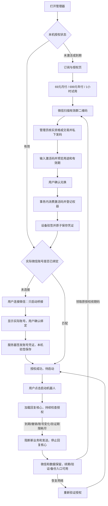

# 订阅与授权：实现方案、完整链路及 TODO

> 2026-10-09，目标版本 0.9.9。首版采用微信群二维码人工发码。授权服务已接入 `https://ss.xiuxianjyj.xin/wechatrebot-license`，客户端已填入生产公钥；商业开关仍关闭，客户安装包尚未更新。
> 本文替代此前的在线支付、短信登录草案，作为本功能的统一实施清单。

## 1. 已确认的规则

| 项目 | 实现规则 |
| --- | --- |
| 月付 | 69 元 / 1 个日历月 |
| 年付 | 699 元 / 12 个日历月 |
| 试用 | 免费 1 小时，通过微信群领取试用码；首次兑换成功起计时，不从打开软件时计时 |
| 开通方式 | 查看套餐 → 微信扫码入群 → 管理员核实 → 私下发码 → 客户预览并确认兑换 |
| 二维码 | 当前为 WXRebot 群，2026-10-16 00:00（北京时间）截止；服务器替换后客户端下次刷新生效 |
| 授权单位 | 一个授权编号、一个有效设备身份、一个机器人微信账号 |
| 客户身份 | 管理员维护稳定客户参考号；服务端保存其哈希，不要求客户注册或提交聊天内容 |
| 续费 | 人工核实后发针对原授权编号的续期码，不自动扣款 |
| 周期 | 北京时间日历月 / 年，服务端存 UTC 时间戳；保留月底锚定日，闰年按日历处理 |
| 提前续期 | 从原有效期接续；试用转付费保留剩余试用时间 |
| 已到期续期 | 从本次成功兑换时间重新起算，不收暂停期间的费用 |
| 模型费用 | 客户自备模型服务和密钥；授权服务不代理聊天、模型请求或保存模型密钥 |
| 离线使用 | 同次 Windows 开机内签名凭证最多 24 小时，且不超过订阅截止；重启电脑后需联网校时 |
| 到期 | 暂停自动化、停止回复核心，保留微信连接、配置和客户数据 |
| 恢复 | 授权重新有效后由用户点击启动；不自动恢复，不补发旧任务和消息 |

首版没有在线付款、付款回调、短信登录、自动扣款、分销或按消息计费。人工交易由管理员核实，“兑换成功”不表示已经核验任何第三方付款。

## 2. 从打开软件到使用的闭环

授权状态读取及每 4 秒的状态轮询不访问授权接口，也不自动创建设备身份。预览、兑换、绑定、重新验证和运行时后台刷新才发出授权请求。群二维码通过独立匿名接口首次读取、每 60 秒更新，用户也可主动刷新；不读取设备凭据、微信账号或聊天资料。二维码请求延迟或失败不阻塞授权表单。状态读取失败会显示原因，不伪装为有效授权。

| 步骤 | 客户操作 / 所见 | 后台处理 | 中断后的处理 |
| --- | --- | --- | --- |
| 进入 | 状态、套餐、截止时间 | 读取本机凭证和实际微信状态 | 服务未配置时明确提示待配置 |
| 加群 | 微信扫码，可放大二维码，显示北京时间有效期 | 从固定 HTTPS 服务读取 PNG/JPEG 资料，服务端原子更新 | 过期/清空则隐藏图片；刷新失败只可回退仍有效内置图并显示失败原因，已有激活码仍可兑换 |
| 领取 | 告知管理员新开通、续期或恢复意图 | 核实稳定客户身份、交易或试用资格 | 同一业务编号不能重复发码 |
| 预览 | 输入码，核对套餐、用途、预计截止时间 | 校验码但不消费；生成有效 5 分钟的预览凭据 | 失效或授权版本改变需重新确认 |
| 兑换 | 明确点击确认兑换 | 同一事务消费码、登记权益、绑定设备，随后签发 | 响应丢失可重试，不重复加时、不要求再次购买 |
| 设备激活 | 设备已激活，待连接微信 | 验证签名、设备、nonce、版本和期限后原子落盘 | 写盘失败不能显示成功，可重新领取原权益 |
| 连接 | 点击连接微信并登录 | 只启动桥接、识别实际身份 | 不加载回复插件、模型或定时业务 |
| 绑定 | 查看真实账号并确认 | 再次读取账号，和用户确认值比对后绑定 | 如果切换了账号则拒绝，要求重新查看 |
| 就绪 | 套餐、截止时间、微信账号、授权编号 | 回读已保存凭证 | 可以继续配置模型，不隐式启动 |
| 启动 | 点击启动机器人 | 校验授权与账号、创建运行会话、加载回复核心 | 失败保留微信，清除运行许可后允许重试 |

账号来自当前机器人桥接状态，不能以任意输入的 wxid 作为绑定依据。设备激活、微信绑定和机器人已经运行分别展示。

二维码有效期独立于试用及付费期限。客户端以服务端时间、请求耗时及单调时钟计算二维码剩余时间，页面按该剩余时间隐藏图片；修改本机时钟不能延长展示。已经收到服务端清空结果的管理器进程，后续断网不会重新展示内置旧图。页面的“刷新二维码”只读取管理员最新上传的资料，不能替微信群生成新码。

## 3. 激活码生命周期

服务使用安全随机码，数据库仅保存摘要。码是领取服务端权益的秘密凭据，不能在客户端离线推导有效期。管理员工具只在服务器本机运行，没有公网管理员接口。

| 码用途 | 管理员需提供 | 兑换结果 | 是否增加时长 |
| --- | --- | --- | --- |
| 新开通 `new` | 稳定客户参考号、唯一业务编号、试用/月付/年付 | 新权益绑定兑换设备 | 是，从首次兑换开始 |
| 续期 `renewal` | 原授权编号、同一客户参考号、业务编号、月付/年付 | 更新原 `license_id`，保留设备和微信 | 是，按提前/到期规则接续 |
| 补领 `recovery` | 原授权编号、同一客户参考号、业务编号 | 原设备重新取得原权益 | 否，保留原截止时间 |
| 迁移 `migration` | 原授权编号、目标设备指纹、同一客户参考号、业务编号 | 明确迁移设备；可显式重置微信绑定 | 否，保留原截止时间 |

- 未兑换码默认 30 天内领取，管理员可指定 1～365 天；领码期限与订阅时长分开。
- 预览凭据绑定设备、码、目标授权及版本；不能拿别人的预览凭据兑换。
- 同设备重试已兑换码恢复当前原权益，不再加时；另一设备不能靠旧码抢走授权。
- 并发兑换使用写事务，保证只有一个设备获得该码权益。
- 试用历史按稳定客户、设备和微信账号检查；重发码不重置历史。管理员不能以变化的订单号替代客户身份。
- 签发或传输失败不会退回已消费码；再次请求原权益即可恢复交付。
- 撤销未用码只撤销该码；停用已兑换权益必须按授权编号撤销。

### 重装、换机与换微信

设备私钥由 Windows 当前用户 DPAPI 保护。正常重开应用保留设备身份；同设备丢失授权缓存可用补领恢复。私钥丢失、换 Windows 用户或换电脑时，需要管理员迁移，不能悄悄重置后重新试用。

新安装在订阅页点击“获取本机设备编号”，显式生成身份并复制指纹给管理员。管理员核实购买者后签发锁定新指纹的迁移码。默认保留原微信；只有核实换微信请求后才允许重新绑定。

新设备已有同一客户的试用或已到期付费授权时，迁移预览会同时展示将被停用的本机授权和迁入的原授权。明确确认后，在同一事务中完成替换，保留原到期时间和试用历史，不合并时长。不同客户、不同设备、已撤销或仍有效的付费授权不能直接替换。响应丢失后可用同一码恢复此次迁入，不能借此切换任意授权。

迁移或撤销在旧设备下次联网刷新时生效。旧设备已持有的有效离线凭证，最长仍可使用 24 小时且不超过订阅截止；首版不承诺离线时即时踢下线。

## 4. 到期、断网及恢复

| 状态 | 后台行为 | 客户可做什么 |
| --- | --- | --- |
| 授权有效 | 执行前和发送前检查，运行中约每 30 分钟刷新 | 正常使用，提前兑换续期码 |
| 服务暂不可达，凭证仍有效 | 按当前签名截止继续使用，失败退避 | 查看剩余期限，主动验证 |
| 订阅到期 | 拒绝新业务和最终发送，清除运行许可，退出回复核心 | 领取续期码；查看、备份和导出数据 |
| 离线凭证过期 | 暂停，说明需要联网验证 | 恢复网络，点击重新验证 |
| 已撤销/已迁移 | 收到拒绝或签名撤销状态后暂停 | 联系管理员 |
| 系统时钟异常 | 暂停并要求联网校准；重启不重新赠送试用 | 校准系统时间后重新验证 |
| 实际账号不匹配 | 拒绝业务并暂停，不能自动改绑 | 登录原微信或申请明确换绑 |
| 已恢复有效授权 | 保持暂停，等待用户启动 | 点击启动机器人 |

正常暂停保留微信桥接。若后台刷新占用授权锁或授权存储故障，导致运行许可不能可靠撤销，则额外停止桥接进程以阻断残留发送；保留客户数据，并提示稍后重新连接。重新连接必须先成功清除旧运行许可，不能借旧会话恢复自动化。

关闭软件或重启电脑后，在桥接和回复核心均未运行时，仍可凭本机经过签名及设备校验的账号绑定查看、导出自己的历史记录。页面标明“离线记录”并禁用删除；离线数据身份不会冒充已登录微信，不能用于绑定、启动或其他业务操作。缓存损坏、账号不匹配或桥接状态未确认时，拒绝使用该后备身份。

期限由服务端签名时间与本地单调时钟共同判断，`lease_until` 不超过 `valid_until`。持久化 Windows 内核启动标识；重启电脑或单调时钟回退后必须联网校时，避免恢复旧缓存再调时钟延长试用。到期检查不等待网络刷新返回，也不依赖管理器窗口存活。

回复核心、流水线阶段、模型调用、桥接业务入口和最终写入均检查授权。登录、健康检查和必要读取保持可用；消息业务在身份处理后被过滤。出站队列绑定运行会话，恢复时不补发旧会话内容；核心退出会丢弃内存中的旧任务。

到期前已经发往外部服务的请求可能完成，不能承诺撤回已送出的网络请求；返回后仍须通过发送前检查。任意第三方插件在本机执行自定义 Python 的情况下，也不能把这套本地保护描述为“无法破解”。服务端只信任自己的权益、签名和事务记录。

## 5. 代码结构与复用

| 位置 | 职责 |
| --- | --- |
| `licensing/protocol.py` | 唯一套餐定义、严格 JSON、签名协议、日历周期 |
| `licensing/config.py`、`licensing-channel.json` | HTTPS 服务、公钥和商业开关；商业包固定信任根 |
| `licensing/contact.py`、`contact_client.py`、`licensing-contact.json` | 公共二维码校验、独立请求/缓存/可信时间和内置有效图，不进入回复核心 |
| `licensing/client.py`、`device.py`、`cache.py` | 设备密钥、本机验签、可信时间、运行会话和原子持久化 |
| `licensing/api.py`、`app_shell.py` | 复用现有本地 API、动作锁和生命周期 |
| `app_webui/subscription.js`、`subscription.css` | 复用主界面导航、确认弹窗、提示和维护入口 |
| `launcher.py`、`lifecycle.py` | 复用进程身份校验、接管和完全停止检查，分阶段启动、只停回复核心；保留旧任务迁移门禁 |
| `licensing/runtime_guard.py`、核心/桥接补丁 | 独立刷新、执行检查、最终发送检查和旧队列隔离 |
| `backup.py` | 复用备份与恢复校验，排除并拒绝恢复授权私钥/状态/配置 |
| `services/activation_service/` | aiohttp 客户接口、SQLite 权益事务、管理员本地发码及更新二维码 |
| `deploy/activation-service/`、`deploy/nginx/wechatrebot-license*.conf` | 独立容器、受限端口、托管和 HTTPS 路由；复用已有域名 |
| `licensing/bundle.py`、构建脚本 | 同一源码复制最小运行时模块并校验指纹，拒绝复用旧授权核心；商业包的管理器增量同样检查授权基线 |

表中管理器路径均相对 `src/wechatrebot_manager/`。沿用现有 cryptography、原子 JSON、单实例锁和进程管理。服务器私钥、激活码数据库和管理员工具不进入客户包。

## 6. TODO 与验收状态

### 已实现及自动验证

- [x] 69 元/月、699 元/年、1 小时试用，服务端和客户端共享规则。
- [x] 微信二维码、内置回退提示、过期隐藏和服务端清空；领取入口异常不阻塞兑换。
- [x] 二维码 60 秒缓存及单独刷新，不随授权状态轮询下载；页面倒计时不受本机墙钟回拨影响。
- [x] 预览及明确兑换；轮询不清空输入。
- [x] 新开通、续期、补领、迁移、撤销；重复兑换、并发和响应丢失恢复。
- [x] Ed25519 请求与凭证、nonce 防重放、版本校验、限流和日志脱敏。
- [x] DPAPI 及原子持久化；商业包开关、公钥和服务地址固定。
- [x] 只连接微信 → 实际账号确认 → 绑定 → 用户启动；API 和进程入口均校验。
- [x] 到期只停止回复核心，续期后明确恢复；授权存储损坏也不能阻止停止进程。
- [x] 到期且完全离线后，可查看和导出已验证账号的本机历史；禁止跨账号读取及离线删除。
- [x] 备份不导出设备私钥/授权缓存，恶意备份也不能覆盖这些文件。
- [x] 真实临时 HTTP 服务的客户端联调：激活、到期、续期、撤销、响应丢失和迁移。
- [x] 浏览器预览验证兑换、绑定、显式启动及输入保留。
- [x] 运行时补丁定向验证：执行、模型、最终发送、旧队列与延迟动作跨会话隔离。
- [x] 复用仓库 `vendor/` 固定源码验证补丁，不新增重复源码副本。
- [x] 商业管理器增量检查授权模块和核心补丁基线；不兼容时拒绝更新，不自动构建。

代码提交、PR 和完整 CI 的交付状态以本功能 PR 的当前检查结果为准；本地定向测试不代替 CI 或真实安装验收。

### 正式启用前必须完成

- [x] 接入用户提供的 WXRebot 微信群二维码，明确 2026-10-16 零点截止。
- [x] 47.242.208.64 上部署独立授权容器，复用 ss.xiuxianjyj.xin HTTPS，保持 NTP、独立账号和仅回环端口。
- [x] 在受控目录初始化独立私钥、数据库、systemd 托管及容器健康检查。
- [x] 公网健康、二维码内容、请求签名与重放拒绝验证；原网站和稳定更新清单内容保持一致。
- [x] 将真实 HTTPS 服务和公钥写入包内 `licensing-channel.json`，二维码独立配置。
- [x] 以专用账号执行每日 SQLite 在线备份，保留最近 14 份；现场验证独立容器恢复数据库、私钥和二维码。
- [ ] 启用商业开关，再构建、验收商业包。
- [ ] 将受控备份复制到独立存储，并完成异机灾备演练。
- [ ] 干净安装验证真实微信登录、绑定、到期停止、续期恢复、换机和数据保留。
- [ ] 维护者明确授权后进行完整载荷构建、安装验收及发布。

当前包内 `enabled:false` 保持既有安装行为，商业授权尚未启用。`config/licensing.json` 仅供默认未启用包本地联调；正式商业包使用包内信任根，忽略本地覆盖。服务已上线与客户安装包已启用收费是两个独立状态。

整个授权功能涉及 AstrBot 核心补丁和运行时模块，属于 **完整载荷更新**，不能只更新管理器。本轮已部署独立授权服务，没有构建客户载荷、更新本地安装或发布客户包。将来需要本地完整载荷时，使用桌面“本地打包完整载荷”入口，并先完成当次构建确认。之后日常替换群二维码无需重新构建客户包或回复核心。

## 7. 管理员交付指引

服务器操作、发码、撤销、查询、恢复和迁移参数统一维护在 [授权服务 README](../../services/activation_service/README.md)，当前服务器路径和核验结果见 [部署记录](../../deploy/activation-service/README.md)。管理员保存业务编号、稳定客户参考号和授权编号，不通过客户备份保存设备凭据。

恢复授权时先区分“同设备丢缓存”“私钥丢失/换电脑”和“增加时间”，分别使用补领、迁移和续期。不要以再次发一个新开通码代替已有权益恢复。

## 8. 本地验证记录

以下命令均在本功能独立工作区执行，只使用临时数据、受控签名测试对象、HTTP 测试服务或进程替身。各组包含交叉测试，不累计为独立用例总数。

| 定向命令 | 结果 |
| --- | --- |
| `python -m pytest tests/test_activation_service.py tests/test_license_protocol.py tests/test_license_client.py tests/test_license_client_integration.py tests/test_license_runtime_guard.py -q` | 223 通过 |
| `python -m pytest tests/test_license_history.py tests/test_license_api.py tests/test_license_lifecycle.py tests/test_app_shell.py tests/test_launcher.py tests/test_lifecycle.py tests/test_history_webui.py tests/test_subscription_webui.py -q` | 165 通过 |
| `python -m pytest tests/test_license_api.py tests/test_legacy_migration_api.py tests/test_subscription_webui.py tests/test_license_history.py tests/test_startup_errors.py -q` | 后续边界补充，46 通过 |
| `python -m pytest tests/test_local_incremental_update.py tests/test_license_runtime_patches.py tests/test_staging_builder.py tests/test_build_local_package.py tests/test_runtime_builder.py tests/test_release_metadata.py -q` | 构建入口及补丁集成，100 通过 |
| `python -m pytest tests/test_backup.py tests/test_build_manager.py -q` | 23 通过，构建过程使用替身 |

上述表格为此前激活码主体的验证记录；本轮微信二维码改动另执行定向测试及浏览器验证，结果以当前 PR 为准。生产验证已覆盖 HTTPS 接口和客户端匿名取码，不代表真实微信、完整载荷或已安装客户版本已经验收。

2026-10-09 微信二维码及部署补充验证：

- `python -m pytest tests/test_activation_contact_service.py tests/test_activation_service.py tests/test_license_contact.py tests/test_license_contact_client.py tests/test_license_api.py tests/test_license_protocol.py tests/test_license_client.py tests/test_license_client_integration.py tests/test_license_runtime_guard.py tests/test_dev_manager.py tests/test_build_manager.py tests/test_subscription_webui.py -q --tb=short`：333 通过。
- `python -m pytest tests/test_activation_backup.py -q --tb=short`：21 通过，1 个 POSIX 专用断言在 Windows 跳过；Ubuntu 22.04 / Python 3.10 原生权限、WAL、跨用户拒绝、锁与轮转验证通过。
- 相关 Python 编译、JS 语法、`python scripts/validate_release_metadata.py` 和 `git diff --check` 通过。
- Edge 浅色/深色，1440×1180、1080×680、390×844：二维码展开、每 60 秒更新、过期隐藏、输入保留、过期码图下续期保持暂停，控制台无错误。
- 生产 HTTPS、实际客户端匿名读取、无效码拒绝、nonce 重放拒绝、原站点内容保持、首次备份与独立容器恢复均已验证；没有生成或兑换生产客户激活码。
